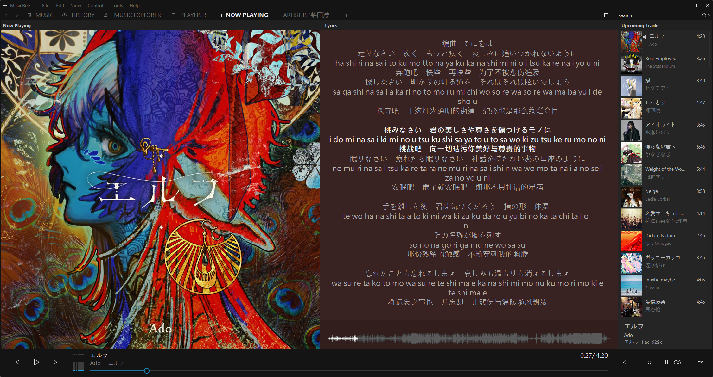
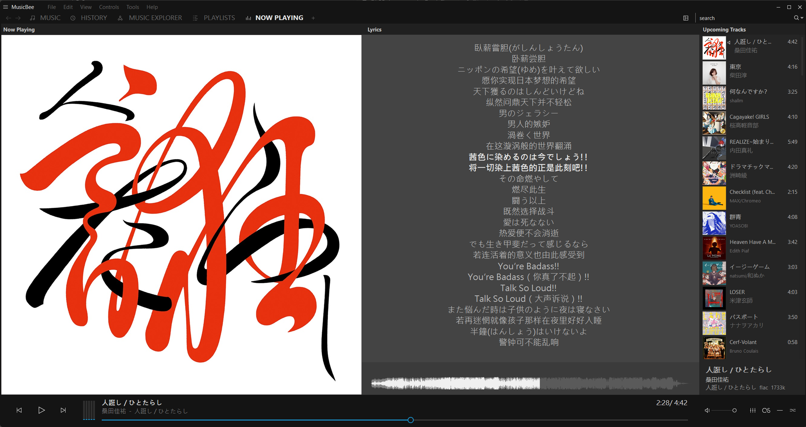
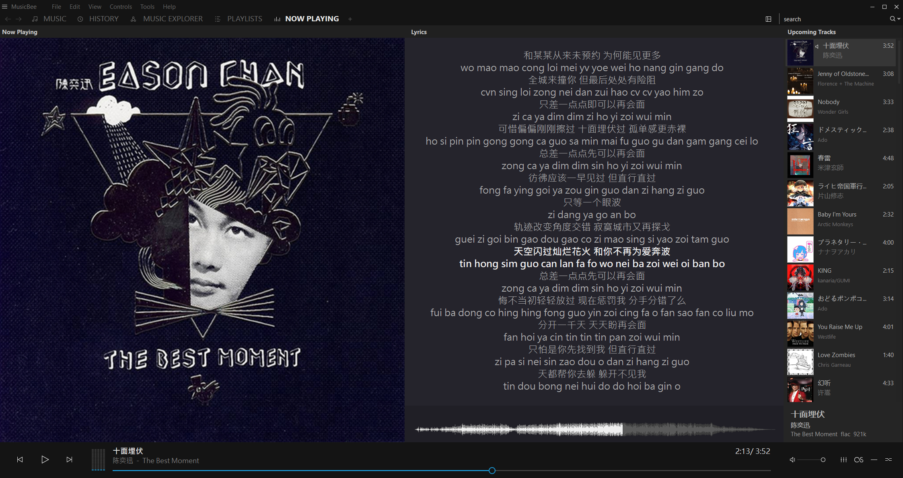

# LyricBee — NetEase Lyrics for MusicBee

**EN** | [ZH（简体中文）](README.zh-CN.md) | **[Download & install ↓](#download-and-install)**

A lyrics retrieval plugin for [MusicBee](https://getmusicbee.com/) that downloads synchronized lyrics from NetEase Cloud Music (网易云音乐), with optional translation and pronunciation.

LyricBee is an independently maintained continuation of [cqjjjzr/MusicBee-NeteaseLyrics](https://github.com/cqjjjzr/MusicBee-NeteaseLyrics), originally written by Charlie Jiang. It includes the reliability, matching and display improvements developed through **1.9.1-pre.1–pre.12**. The original licenses and upstream Git history are retained. Ongoing development and issue tracking take place in this repository on **master**. The [previous fork](https://github.com/tonyzehs/MusicBee-NeteaseLyrics) preserves historical download links.

## Feature additions

[](docs/screenshots/japanese-three-line.png)

### Original, translation and pronunciation displays

Original lyrics are always included. Choose the extras and their layout separately:

- **Translation** — enabled by default.
- **Pronunciation** — disabled by default; availability depends on NetEase and the song's language.
- **Layout** — **Separate lines** by default, or **Same line: JP / CN**, using a spaced ` / ` separator.

Turn both extras off for original lyrics only. Language overrides can independently replace this default selection.

Separate-line timed output groups the original and its extras under one timestamp:

```text
[00:12.300]Original lyrics
Translated lyrics
[00:17.500]Next original line
Next translated line
```

With pronunciation and translation selected, a cue can contain three lines:

```text
[00:12.300]Original lyrics
Pronunciation
Translated lyrics
```

The continuation lines belong to the original cue; the plugin does not repeat its timestamp or add a slash marker to separate-line output. The screenshots show two- and three-line highlighting in MusicBee's Now Playing panel. MusicBee controls wrapping and appearance in other panels.

### Language overrides

The language-specific controls appear together under **Language overrides**. Every language starts at **Follow default** on a fresh installation.

| Language | Choices besides Follow default |
| --- | --- |
| Japanese | Lyrics; Lyrics + Translation; Lyrics + Pronunciation; Lyrics + Pronunciation + Translation |
| Korean | Lyrics; Lyrics + Translation; Lyrics + Pronunciation; Lyrics + Pronunciation + Translation |
| Cantonese | Lyrics; Lyrics + Pronunciation |
| English | Lyrics; Lyrics + Translation |

**Follow default** uses the default extras for that language. A specific choice replaces them, even when both default extras are off. Layout remains common to all languages. Cantonese offers pronunciation, while English offers translation.

Pronunciation comes from NetEase's `romalrc` track; the plugin does not generate readings locally. For triple-line output, missing or safely unalignable extras are omitted independently. If neither is available, the original is retained. Pronunciation-only does not substitute translation when pronunciation is unavailable.

The plugin uses NetEase's song-language label, with conservative kana/Hangul detection when needed. Han characters alone cannot identify Cantonese, and Latin letters alone do not identify English. An English translation override therefore does not turn off translations for French and other languages. Unsupported, multilingual or unresolved labels retain the default translation preference.

Saved preferences carry over when upgrading. The former global Translation-only choice becomes original + translation; original-only keeps extras off. Older Cantonese translation choices become Lyrics or Lyrics + Pronunciation. Before the first save of an older configuration, the plugin retains `netease_config.pre-display.bak` beside `netease_config` in MusicBee's persistent plugin storage. Older builds cannot represent every new override combination: close MusicBee and restore that backup if exact previous preferences are needed after rollback.

### English and Simplified Chinese interface

**Interface language / 界面语言** offers **Automatic / 自动**, **English**, and **简体中文**. Automatic follows the Windows UI culture available to the plugin; Chinese cultures use Simplified Chinese text. Changing interface language preserves unsaved choices and does not change the lyric language.

### Two-line examples

Click either preview to open the full-size screenshot.

| Japanese: lyrics + Chinese translation | Cantonese: lyrics + pronunciation |
| :---: | :---: |
| [](docs/screenshots/japanese-two-line.png) | [](docs/screenshots/cantonese-two-line.png) |

### Untimed lyrics

When original lyrics have no timestamps, compatible lines are displayed as `Original / Translation`, or `Original / Pronunciation / Translation`. There are no language-specific labels. Original verse breaks and section markers are retained.

If line counts differ but verse structure agrees, each verse's original lines are followed by its available pronunciation/translation lines. Incompatible structures retain the original rather than forcing correspondence. The plugin never invents timestamps or borrows translation timing for an untimed original.

### More careful automatic matching

Title, artist, album and available duration contribute to matching. The plugin rejects contradictory or ambiguous recordings rather than choosing an unrelated song simply because its duration is close.

- Numbered titles remain distinct; explicit **Pt. II** and **Part 2** can agree.
- Live, remix, radio-edit and other meaningful version labels remain significant.
- Recognized remaster notes can be ignored. Mono/stereo and album-version notes require known, closely matching durations.
- Compatible duplicate catalogue listings are grouped. If the chosen listing lacks lyrics or requested extras, another compatible listing can be tried.
- A terminal soundtrack attribution such as **(from the series Arcane League of Legends)** can be ignored only when complete artist credits, album, duration and the named work corroborate it. Meaningful title words and recording-version labels remain significant.

Missing tags, translated titles or unresolved editions can still prevent a confident match. The manual song override remains available.

### Real-song examples

These cases show the earlier lookup failures and the corrected results. Both automatic lookups were verified in MusicBee with the existing file tags and no Custom10 override.

| Recording | Earlier lookup behavior | Corrected result |
| --- | --- | --- |
| **[By Your Side](https://music.163.com/song?id=400875204)** — 澤田かおり / 服部隆之, from the *Mobile Suit Gundam The Origin* soundtrack | Paired the Japanese recording with unrelated Cantonese lyrics. | Retrieves the intended recording, **ID 400875204**. Recognizes the singer alongside the composer credit, checks title/artist/album/duration, and rejects unrelated songs. |
| **[Ma Meilleure Ennemie](https://music.163.com/song?id=3374505659)** — Stromae / Pomme, from the *Arcane Season 2* soundtrack | Returned no lyrics even though the correct recording was available. NetEase appends **(from the series Arcane League of Legends)** to the title, while the local title omits it. | Retrieves the intended recording, **ID 3374505659**. Accepts the soundtrack attribution only when the artist credits, album, duration and named work corroborate the match. |

Re-fetch affected tracks to replace lyrics MusicBee already stored.

### Select a specific NetEase song

Set the requested music file's **Custom10** tag to a NetEase song URL or `netease=ID`, then re-search:

```text
https://music.163.com/#/song?id=29126914
https://music.163.com/song?id=29126914
https://y.music.163.com/m/song?id=29126914
netease=29126914
```

Desktop and phone-share song links are supported. Album, playlist, artist and unrelated-domain links are rejected. The override belongs to the file being searched, including background lookups while a different song is playing.

### Matching and network options

**Allow small spelling differences** is a single checkbox, enabled by default. Turning it off requires stricter spelling agreement. Existing effective spelling preferences are retained when upgrading. Number, artist and recording checks still apply.

**Allow HTTP fallback (unencrypted metadata)** is enabled by default. HTTPS is tried first. Plain HTTP is used only after a transport failure on the legacy HTTPS interface; a secure HTTP/API refusal prevents that downgrade for the lookup. Turn this option off to require HTTPS. Optional language metadata always uses HTTPS.

No login or account cookie is required. Anonymous server cookies are not stored and replayed between requests. The plugin supplies lyric text to MusicBee; MusicBee handles display and storage.

## Download and install

Download `LyricBee-NetEaseLyrics_[version].zip` from the [latest release](https://github.com/tonyzehs/LyricBee-NetEaseLyrics/releases/latest). The install ZIP contains `mb_NeteaseLyrics.dll`, the license/attribution files, and bilingual installation instructions; runtime dependencies are embedded. Source packages and checksums are available with each release. Older development releases are retained for reference; use the latest stable release for normal installation.

The plugin targets Windows and .NET Framework 4.8.

1. Open MusicBee’s **Preferences → Plugins**, use **Add plugin**, select the ZIP and enable **LyricBee — NetEase Lyrics**.
2. In **Tags (2)**, set the lyrics provider priority to use **Netease Cloud Music**.
3. Open the plugin settings to choose default extras, layout, language overrides and interface language.
4. Re-fetch lyrics for tracks whose display or matching you want to change.

### Upgrading

(Optional) Back up your settings first. Previous plugin versions remain available in the [release history](https://github.com/tonyzehs/LyricBee-NetEaseLyrics/releases), so keeping a copy of the old DLL is unnecessary.

1. Download the latest installation ZIP.
2. Open MusicBee’s **Preferences → Plugins**, use **Add plugin**, and select the new ZIP to update LyricBee.
3. Click the **Restart** button that appears. MusicBee will restart with the updated plugin.
4. Re-fetch lyrics to apply display or matching changes to previously saved text.

MusicBee can keep lyrics it has already downloaded or embedded. Installing an update or restarting playback does not replace that stored text. Clear or replace incorrect lyrics and search again to evaluate a new lookup.

## Build and development history

See [BUILDING.md](BUILDING.md) for the Windows/.NET build instructions and validation details, and [CHANGELOG.md](CHANGELOG.md) for the step-by-step changes. Run `build.ps1` from the repository root to build, test and package the plugin.

The latest build passes **313 regression checks in both 64-bit and 32-bit test processes**, using the packaged DLL with embedded dependencies. Fixtures cover the MusicBee callback, matching, timing, configuration and controlled network failures; they do not replace native MusicBee testing or guarantee NetEase availability in every region.

The [release history](https://github.com/tonyzehs/LyricBee-NetEaseLyrics/releases) includes the historical development milestones and LyricBee releases. Each release uses its original build packages; smaller updates are included in the next milestone. Padded prerelease tags keep the listing in numeric order. Tags identify archived source snapshots, and release dates reflect their publication. Source packages include the documentation from their respective builds.

| Milestone | Included development steps | Main changes |
|---|---|---|
| [1.9.1-pre.1](https://github.com/tonyzehs/LyricBee-NetEaseLyrics/releases/tag/v1.9.1-pre01) | pre.1 | Reliability and build foundation |
| [1.9.1-pre.4](https://github.com/tonyzehs/LyricBee-NetEaseLyrics/releases/tag/v1.9.1-pre04) | pre.2, pre.3, pre.4 | Safer matching and network recovery |
| [1.9.1-pre.7](https://github.com/tonyzehs/LyricBee-NetEaseLyrics/releases/tag/v1.9.1-pre07) | pre.5, pre.6, pre.7 | Separate-line bilingual lyrics |
| [1.9.1-pre.9](https://github.com/tonyzehs/LyricBee-NetEaseLyrics/releases/tag/v1.9.1-pre09) | pre.8, pre.9 | Recording identity, alignment and compatibility |
| [1.9.1-pre.10](https://github.com/tonyzehs/LyricBee-NetEaseLyrics/releases/tag/v1.9.1-pre10) | pre.10 | Pronunciation and three-line lyrics |
| [1.9.1-pre.11](https://github.com/tonyzehs/LyricBee-NetEaseLyrics/releases/tag/v1.9.1-pre11) | pre.11 | Soundtrack attribution matching |
| [1.9.2](https://github.com/tonyzehs/LyricBee-NetEaseLyrics/releases/tag/v1.9.2) | pre.12, 1.9.2 | Language choices and translation defaults |
| [1.9.3](https://github.com/tonyzehs/LyricBee-NetEaseLyrics/releases/tag/v1.9.3) | 1.9.3 | Standalone LyricBee project and display name |
| [1.9.4](https://github.com/tonyzehs/LyricBee-NetEaseLyrics/releases/tag/v1.9.4) | 1.9.4-test.1, test.2, 1.9.4 | Bilingual settings, independent extras, language overrides and simpler spelling controls |

## Bug fixes, maintenance and other improvements over upstream v1.9.0-pre

### Bug fixes

- Handle refused, malformed, incomplete and missing network answers without crashing; try the legacy lyric interface when a successful newer response contains no usable lyrics.
- Handle missing tags and fractional durations safely, and use MusicBee's callback metadata when file tags are unavailable. An unknown duration no longer favors the shortest candidate.
- Replace the squared duration penalty and unchecked first-result selection with bounded scoring, identity checks and ambiguity rejection, reducing wrong-song pairing.
- Preserve real artist names such as AC/DC, Simon & Garfunkel and Tyler, The Creator; parse actual featured-artist clauses without damaging words such as “feather” or “featuring.”
- Prevent background lookups from borrowing Custom10 from the currently playing song; validate overrides and support mobile song links.
- Normalize and sort lyric times numerically, retain metadata/offsets, handle repeated and simultaneous cues, and align each extra once within the firm 50 ms limit. Compare raw and adjusted clocks conservatively.
- Preserve untimed originals, omit blank/slash-only auxiliary placeholders, and avoid trailing separators. Treat explicit instrumental responses and NetEase's pure-music placeholder as no lyrics.
- Validate saved settings, isolate malformed newer preference fields, save atomically and preserve valid choices when migration cannot be written. Store the two-line preference in an older-compatible format.

### Maintenance and other improvements

- Bound each lookup to 30 seconds, reserving lyric-fetching time after search. Cap actual sends at nine search and nine lyric-phase requests, including fallback and optional language metadata; stop reusing timed-out interfaces within that lookup.
- Reuse requests without replaying anonymous server cookies, disable automatic redirects, and provide an explicit HTTP fallback opt-out. The cookie replay problem introduced in this fork's pre.1/pre.2 builds was corrected in pre.3.
- Emit concise MusicBee trace diagnostics in Release builds for failures, matching rules and compatible-listing retries, without logging downloaded lyric bodies or local file paths.
- Use an SDK-style project, pinned SDK, locked dependencies, an isolated build/package script and Windows CI. Remove unused Harmony and embed only required runtime dependencies, reducing the DLL from roughly 4 MB upstream to roughly 1.1 MB.
- Add permanent recorded-metadata and synthetic lyric fixtures, both process architectures, real loopback transport probes, settings compatibility checks and reproducible packaging checksums. Byte-identical rebuilds in different folders are not claimed.
- Shorten clipped settings descriptions, retain saved preferences, simplify spelling matching to one checkbox, and separate default extras, common layout and language overrides. Add English/Simplified Chinese settings and a rollback backup for the new display preferences.

The project remains under [Apache 2.0](LICENSE), with the retained [Zony MIT notice](LICENSE-Zony) for adopted API code. Credit for the original plugin and its upstream history belongs to Charlie Jiang and the upstream contributors. LyricBee is maintained by [Tony Y](https://github.com/tonyzehs). See [NOTICE](NOTICE) for attribution.
