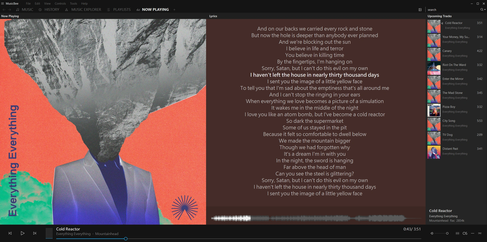

# LyricBee — MusicBee 网易云音乐歌词插件

[EN](README.md) | ZH（简体中文） | [下载与安装 ↓](#下载与安装)

LyricBee 为 [MusicBee](https://getmusicbee.com/) 获取网易云音乐的同步歌词，还可以在原文旁显示翻译和发音。

本项目基于 [Charlie Jiang 编写的网易云歌词插件](https://github.com/cqjjjzr/MusicBee-NeteaseLyrics)，现已独立维护，保留原许可证和 Git 历史。遇到问题请在本仓库[提交反馈](https://github.com/tonyzehs/LyricBee-NetEaseLyrics/issues)。

## 新增功能

[](docs/screenshots/japanese-three-line.webp)

### 原文、翻译和发音显示

原文歌词始终显示。在插件设置中，可以选择添加：

- **翻译**：默认开启。
- **发音**：默认关闭。
- **排列方式**：默认 **分行显示**，也可选择 **同行显示：JP / CN**，以带空格的 ` / ` 分隔。

关闭翻译和发音即可只看原文。在 MusicBee 的“正在播放”面板中，原文、发音和翻译可以一起滚动、高亮。文字换行和外观取决于所用的面板与皮肤。

翻译和发音均来自网易云，是否提供取决于歌曲。如果某一项缺失或时间对不上，就显示其余可用的内容。只选择发音时，缺少读音的歌曲会显示原文。

### 语言覆盖设置

在 **语言覆盖设置** 下，可以为不同语言单独选择显示内容。首次安装时，各语言都选中 **使用默认设置**，采用上方“翻译”和“发音”复选框的选择。

| 语言 | 其他选项 |
| --- | --- |
| 日语 | 歌词；歌词 + 翻译；歌词 + 发音；歌词 + 发音 + 翻译 |
| 韩语 | 歌词；歌词 + 翻译；歌词 + 发音；歌词 + 发音 + 翻译 |
| 粤语 | 歌词；歌词 + 发音 |
| 英语 | 歌词；歌词 + 翻译 |

选定具体模式后，该语言就按自己的设置显示。例如，大多数歌曲显示翻译，英语歌曲只显示原文。排列方式对所有语言通用。

LyricBee 使用网易云提供的语言信息，也能通过假名和韩文识别部分日语、韩语歌曲。无法判断语言时，按默认设置显示。英语选项只影响被识别为英语的歌曲，法语等其他语言仍采用默认显示方式。

### 英语与简体中文界面

**界面语言 / Interface language** 提供 **自动 / Automatic**、**English** 和 **简体中文**。自动选项跟随 Windows 显示语言，中文系统使用简体中文。切换界面语言会保留当前选择，歌词仍使用原来的语言。

### 双行显示示例

点击预览图可查看原尺寸截图。

| 日语：原文和中文翻译 | 粤语：原文和发音 |
| :---: | :---: |
| [](docs/screenshots/japanese-two-line.webp) | [](docs/screenshots/cantonese-two-line.webp) |

### 仅原文示例

关闭翻译和发音后，只显示英语原文。点击可查看原尺寸截图。

[](docs/screenshots/english-single-line.webp)

### 无时间戳歌词

原文没有时间戳时，使用 `原文 / 翻译` 或 `原文 / 发音 / 翻译` 的格式，保留段落分隔和章节标记。

如果行数不同，但段落能对应上，就在每段原文后显示该段的发音和翻译。段落也无法对应时，只显示原文。歌词要跟随音乐滚动，需要原文本身带有时间戳。

### 更谨慎的自动歌曲匹配

LyricBee 会核对标题、艺人、专辑和歌曲时长，寻找正确录音。如果仍有多个难以区分的版本，就返回无歌词，方便你手动指定歌曲。

- 标题中的编号会区分开；`Pt. II` 和 `Part 2` 可以视为同一部分。
- Live、Remix、Radio Edit 等文字仍用于区分版本。
- 重制版备注可以忽略。Mono、Stereo 和 Album Version 等备注在歌曲时长接近时也可以忽略。
- 同一录音在网易云重复上架时，可以尝试其他条目，补充缺少的歌词、翻译或发音。
- 能处理原声带标题附加的来源文字，例如 `(from the series Arcane League of Legends)`。本地专辑名为中文时，也可在标题、完整艺人名单和时长一致的情况下匹配网易云的英文条目。
- 艺人名称可以通过网易云登记的别名对应起来。标题和专辑须一致，歌曲时长相差须在两秒以内。

标签缺失或多个录音十分相似时，仍可能需要[手动指定歌曲](#手动指定网易云歌曲)。详细规则和已知限制见 [UPSTREAM-CHANGES.md](UPSTREAM-CHANGES.md#matching-and-compatible-listings)（英语）。

### 实际歌曲案例

以下三首歌已在 MusicBee 中使用原有标签、清空 Custom10 后确认可以自动找到歌词。

| 歌曲 | 此前的问题 | 现在的结果 |
| --- | --- | --- |
| [By Your Side](https://music.163.com/song?id=400875204) — 澤田かおり、服部隆之，出自《机动战士高达 THE ORIGIN》 | 日语歌曲配上了无关的粤语歌词。 | 找到正确的日语录音，艺人标签同时包含歌手和作曲者也能识别。 |
| [Ma Meilleure Ennemie](https://music.163.com/song?id=3374505659) — Stromae、Pomme，出自《Arcane》第二季 | 网易云在标题后加上 `(from the series Arcane League of Legends)`，导致无法匹配本地的简短标题。 | 艺人、专辑和时长一致时，可以用本地标题找到这首歌。 |
| [奇縁ロマンス](https://music.163.com/song?id=2032748562) — ナナヲアカリ，网易云显示为七音阿卡莉 | 日文与中文艺人名被当成了不同歌手。 | 根据网易云的艺人别名，将本地日文标签与中文名称对应起来。 |

请重新获取受影响歌曲的歌词，以替换 MusicBee 已保存的旧文本。

### 手动指定网易云歌曲

在音乐文件的 **Custom10** 标签中填入网易云歌曲链接或 `netease=ID`，然后重新搜索歌词：

```text
https://music.163.com/#/song?id=29126914
https://music.163.com/song?id=29126914
https://y.music.163.com/m/song?id=29126914
netease=29126914
```

支持桌面和手机分享的歌曲链接。请使用歌曲本身的链接，而不是专辑、歌单或艺人页面。

### 匹配、网络与隐私

**允许少量拼写差异** 默认开启。关闭后要求拼写一致，歌曲编号、艺人及版本仍会核对。

**允许 HTTP 回退（元数据不加密）** 默认开启。LyricBee 先尝试 HTTPS；连接失败或网易云服务器暂时出错时，可以改用 HTTP。HTTP 会以未加密的方式发送歌曲信息，需要全程使用 HTTPS 时请关闭此项。

搜索时会向网易云发送标题、艺人和专辑，获取歌词时会发送歌曲 ID。使用插件无需网易云账号。歌词的显示和保存由 MusicBee 处理。

### 检查 LyricBee 更新

在插件设置中点击 **检查 LyricBee 更新**，结果会直接显示在原处。有新版本时，点击 **查看更新** 即可打开发布页面。

只有手动点击才会检查更新。检查时不会向 GitHub 发送歌曲信息；下载 ZIP 并添加到 MusicBee 后，才会安装更新。

## 下载与安装

从[最新发布](https://github.com/tonyzehs/LyricBee-NetEaseLyrics/releases/latest)下载 `LyricBee-NetEaseLyrics_[version].zip` 安装包。GitHub 的 Source code 压缩包供开发使用。安装包内含插件、许可证和安装说明，需要校验下载文件时可使用 `SHA256SUMS.txt`。

需要 Windows 上的 MusicBee 3.x 和 .NET Framework 4.8。已在 MusicBee 3.6.9668（Microsoft Store 版）中测试。

1. 打开 MusicBee 的 **首选项 → 插件**，点击 **添加插件**，选择 ZIP 并启用 **LyricBee — NetEase Lyrics**。
2. 在 **标签 (2)** 中，将 **Netease Cloud Music** 加入歌词提供者优先级列表。
3. 打开插件设置，选择翻译、发音、排列方式和界面语言。
4. 对需要更新的歌曲重新搜索歌词。

### 升级

（可选）先备份设置。旧版可从[发布历史](https://github.com/tonyzehs/LyricBee-NetEaseLyrics/releases)下载。

1. 下载最新安装 ZIP。
2. 打开 **首选项 → 插件 → 添加插件**，选择新的 ZIP。
3. 点击出现的 **Restart（重启）** 按钮，MusicBee 将重启并加载新版插件。
4. 清除并重新获取已保存的歌词，以应用新的匹配规则或显示设置。

升级会保留设置。如果回退到旧版插件，请保留当前设置文件；恢复旧备份可能重新带回之前的匹配问题。旧设置的详细说明见 [INSTALL.md](INSTALL.md)。

MusicBee 会保留已下载或写入音乐文件的歌词。重新获取后才能替换旧文本，仅重新播放歌曲会继续使用原来的歌词。

## 常见问题

- 找不到歌词时，检查 **标签 (2)** 中的提供者优先级，再试一次搜索。也可以在 **Custom10** 中填入正确的网易云歌曲链接。
- 配错歌曲时，将 **Custom10** 设为正确的歌曲链接或 `netease=ID`，清除旧歌词后重新获取。
- 还在显示旧歌词时，在 MusicBee 中清除已保存的文本，再重新获取。
- 反馈问题时，请附上网易云歌曲链接，以及 MusicBee 和 LyricBee 的版本。复现问题后，打开插件设置 → **高级… → 复制诊断报告**，将报告粘贴到反馈中。报告只复制到剪贴板，由你决定是否发送；其中的歌曲 ID 可能透露听歌记录，歌词、标签、文件路径和账号信息不会包含在内。

## 相对上游 v1.9.0 的修复

- 网络请求失败或标签缺失时，避免插件崩溃。
- 核对更多歌曲信息，减少错配；歌词缺失时尝试同一录音的其他条目。
- 原文、翻译和发音一起显示，并修复时间对齐和无时间戳文本的处理。
- 限制搜索等待时间，连接失败时尝试其他方式。
- 提供英语和简体中文设置，显示内容与排列方式分别选择。
- 插件更小：移除未使用的依赖后，DLL 从约 4 MB 缩小至 1.1 MB。

完整列表见 [UPSTREAM-CHANGES.md](UPSTREAM-CHANGES.md)（英语）。

## 构建与开发历史

在 Windows 上构建和测试插件的方法见 [BUILDING.md](BUILDING.md)，各版本变更见 [CHANGELOG.md](CHANGELOG.md)。开发使用 `dev` 分支，稳定更新发布到 `master`。

[发布历史](https://github.com/tonyzehs/LyricBee-NetEaseLyrics/releases)保留了此前的版本，[旧分支仓库](https://github.com/tonyzehs/MusicBee-NeteaseLyrics)也保留原有下载链接。

<details>
<summary>早期版本里程碑</summary>

| 里程碑 | 包含的开发版本 | 主要变更 |
| --- | --- | --- |
| [1.9.1-pre.1](https://github.com/tonyzehs/LyricBee-NetEaseLyrics/releases/tag/v1.9.1-pre01) | pre.1 | 减少崩溃，完善构建方式 |
| [1.9.1-pre.4](https://github.com/tonyzehs/LyricBee-NetEaseLyrics/releases/tag/v1.9.1-pre04) | pre.2、pre.3、pre.4 | 改进匹配及网络恢复 |
| [1.9.1-pre.7](https://github.com/tonyzehs/LyricBee-NetEaseLyrics/releases/tag/v1.9.1-pre07) | pre.5、pre.6、pre.7 | 双行歌词 |
| [1.9.1-pre.9](https://github.com/tonyzehs/LyricBee-NetEaseLyrics/releases/tag/v1.9.1-pre09) | pre.8、pre.9 | 重复录音、时间对齐和旧设置 |
| [1.9.1-pre.10](https://github.com/tonyzehs/LyricBee-NetEaseLyrics/releases/tag/v1.9.1-pre10) | pre.10 | 发音和三行歌词 |
| [1.9.1-pre.11](https://github.com/tonyzehs/LyricBee-NetEaseLyrics/releases/tag/v1.9.1-pre11) | pre.11 | 原声带标题匹配 |
| [1.9.2](https://github.com/tonyzehs/LyricBee-NetEaseLyrics/releases/tag/v1.9.2) | pre.12、1.9.2 | 语言选项和翻译默认值 |
| [1.9.3](https://github.com/tonyzehs/LyricBee-NetEaseLyrics/releases/tag/v1.9.3) | 1.9.3 | 独立 LyricBee 项目及显示名称 |
| [1.9.4](https://github.com/tonyzehs/LyricBee-NetEaseLyrics/releases/tag/v1.9.4) | 1.9.4-test.1、test.2、1.9.4 | 双语设置、独立附加内容、语言覆盖设置及简化拼写选项 |
| [1.9.5](https://github.com/tonyzehs/LyricBee-NetEaseLyrics/releases/tag/v1.9.5) | 1.9.5-test.1–test.4、1.9.5 | 自动修复设置、改进匹配与时间对齐，并在高级设置中提供诊断报告 |
| [1.9.6](https://github.com/tonyzehs/LyricBee-NetEaseLyrics/releases/tag/v1.9.6) | 1.9.6-test.1–test.4、1.9.6 | 手动检查更新、改进诊断报告和自动调整的设置布局 |
| [1.9.7](https://github.com/tonyzehs/LyricBee-NetEaseLyrics/releases/tag/v1.9.7) | 1.9.7-test.1–test.2、1.9.7 | 对应不同语言的艺人名 |

</details>

LyricBee 由 [Tony Y](https://github.com/tonyzehs) 维护。感谢 Charlie Jiang 和上游贡献者编写原插件。项目采用 [Apache 2.0](LICENSE)，所使用的 API 代码保留 [Zony 的 MIT 声明](LICENSE-Zony)。署名说明见 [NOTICE](NOTICE)。
