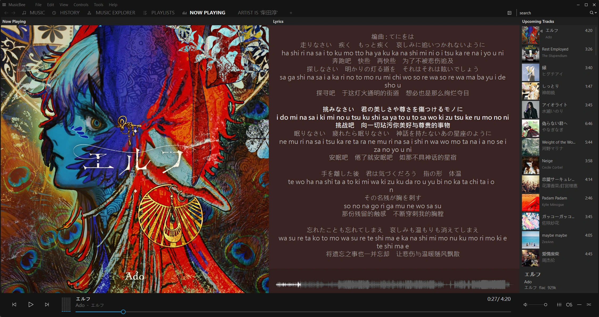
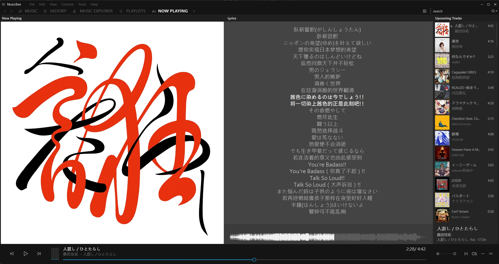
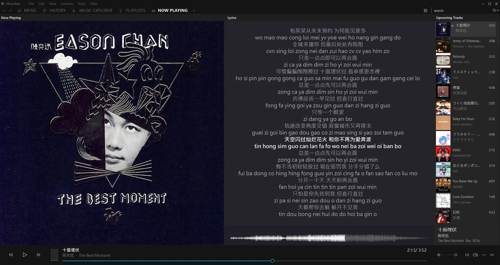

# LyricBee — MusicBee 网易云音乐歌词插件

[EN](README.md) | **ZH（简体中文）** | **[下载与安装 ↓](#下载与安装)**

为 [MusicBee](https://getmusicbee.com/) 获取网易云音乐的同步歌词，并可显示翻译和发音。

LyricBee 是 [cqjjjzr/MusicBee-NeteaseLyrics](https://github.com/cqjjjzr/MusicBee-NeteaseLyrics) 的独立维护版本，原作者为 Charlie Jiang。项目延续 **1.9.1-pre.1–pre.12** 期间的可靠性、歌曲匹配和显示改进，并保留原许可证和上游 Git 历史。开发在本仓库的 **dev** 分支进行，稳定更新保留在 **master**，问题反馈也在本仓库处理。[此前的分支仓库](https://github.com/tonyzehs/MusicBee-NeteaseLyrics)保留历史下载链接。

## 新增功能

[](docs/screenshots/japanese-three-line.webp)

### 原文、翻译和发音显示

原文歌词始终显示，附加内容与排列方式分别设置：

- **翻译**：默认开启。
- **发音**：默认关闭，是否可用取决于网易云和歌曲语言。
- **排列方式**：默认**分行显示**，也可选择**同行显示：JP / CN**，使用带空格的 ` / ` 分隔。

关闭两种附加内容即可仅显示原文。语言覆盖设置可以独立替代这一默认选择。

分行显示时，原文及其附加文本共用一个时间戳：

```text
[00:12.300]原文歌词
翻译歌词
[00:17.500]下一行原文
下一行翻译
```

同时选择发音和翻译时，一个同步段落可显示三行：

```text
[00:12.300]原文歌词
发音
翻译歌词
```

后续行归属于原文的时间戳。插件不会重复该时间戳，也不会在分行显示中添加斜杠标记。截图展示了 MusicBee“正在播放”面板中的双行和三行高亮；其他面板的换行及外观由 MusicBee 控制。

### 语言覆盖设置

各语言的独立选项统一放在**语言覆盖设置**下。首次安装时，所有语言均采用**使用默认设置**。

| 语言 | 除“使用默认设置”外的选项 |
| --- | --- |
| 日语 | 歌词；歌词 + 翻译；歌词 + 发音；歌词 + 发音 + 翻译 |
| 韩语 | 歌词；歌词 + 翻译；歌词 + 发音；歌词 + 发音 + 翻译 |
| 粤语 | 歌词；歌词 + 发音 |
| 英语 | 歌词；歌词 + 翻译 |

**使用默认设置**采用适用于该语言的默认附加内容。选择具体模式时，将替代默认内容，即使上方两种附加内容都已关闭也能单独生效。排列方式对所有语言通用。粤语提供发音选项，英语提供翻译选项。

发音来自网易云的 `romalrc`，插件不会在本地生成读音。三行模式会分别省略缺失或无法可靠对齐的附加内容；两种附加内容都不可用时保留原文。仅发音模式不会在发音缺失时改用翻译。

插件使用网易云的歌曲语言标签，必要时可谨慎根据假名或韩文推断日语、韩语。仅凭汉字无法识别粤语，仅凭拉丁字母也不能识别英语。因此，关闭英语翻译不会同时关闭法语等其他语言的翻译。无法识别、不支持或标为多语言的歌曲保留默认翻译偏好。

升级保留已有选择。旧版全局“仅翻译”迁移为原文加翻译，“仅原文”保持附加内容关闭；旧版粤语翻译选项迁移为“歌词”或“歌词 + 发音”。加载旧设置时会自动修复旧匹配标志，并在 MusicBee 插件持久化存储目录中将原文件保留为 `netease_config.pre-spelling.bak`。回退时请保留修复后的当前设置；恢复历史备份也会恢复其中的旧标志。旧版不能完整表达所有新设置组合，上游 v1.8.1 本身仍采用较弱的匹配规则。

### 英语与简体中文界面

**界面语言 / Interface language**提供**自动 / Automatic**、**English**和**简体中文**。自动选项跟随插件可读取的 Windows 界面文化设置，中文文化设置使用简体中文文本。切换界面语言会保留尚未保存的选择，不会改变歌词语言。

### 双行显示示例

点击任一预览图可打开原尺寸截图。

| 日语：原文 + 中文翻译 | 粤语：原文 + 发音 |
| :---: | :---: |
| [](docs/screenshots/japanese-two-line.webp) | [](docs/screenshots/cantonese-two-line.webp) |

### 无时间戳歌词

原文没有时间戳时，可对应的歌词行显示为 `原文 / 翻译` 或 `原文 / 发音 / 翻译`，无需语言专属标签。原文的段落分隔和章节标记会保留。

行数不一致但段落结构对应时，每段先显示原文，再显示可用的发音及翻译。结构无法对应时保留原文，不强行配对。插件不会生成时间戳，也不会将翻译的时间戳移植到无时间戳的原文。

### 更谨慎的自动歌曲匹配

匹配会参考标题、艺人、专辑及可用的时长。遇到信息矛盾或无法区分的录音版本时，插件会拒绝匹配，避免仅因时长接近而选中无关歌曲。

- 标题中的编号会保留区别；明确标注的 **Pt. II** 和 **Part 2** 可视为一致。
- Live、remix、radio edit 等有实际意义的版本标记仍参与判断。
- 可识别的重新母带制作备注可以忽略；mono/stereo 和 album version 备注仅在双方时长已知且足够接近时允许忽略。
- 可兼容的重复目录条目会归组。选中的条目缺少歌词或所需附加文本时，可尝试同组的其他条目。
- 标题末尾的作品来源，如 **(from the series Arcane League of Legends)**，只有在完整艺人信息、专辑、时长及所指作品共同支持匹配时才可忽略。实质性标题文字和录音版本标记仍然有效。

标签缺失、译名差异或无法确认的版本仍可能阻止匹配。此时可以手动指定网易云歌曲。

### 实际歌曲案例

以下案例展示了此前的检索问题及修复后的结果。两首歌均已在 MusicBee 中使用原文件标签、不设置 Custom10 的情况下确认自动检索成功。

| 录音 | 此前的检索结果 | 修复后的结果 |
| --- | --- | --- |
| **[By Your Side](https://music.163.com/song?id=400875204)** — 澤田かおり / 服部隆之，出自《机动战士高达 THE ORIGIN》原声带 | 日语歌曲被配上了无关的粤语歌词。 | 获取正确录音，**ID 400875204**。可在包含作曲者的艺人标签中识别演唱者，并核对标题、艺人、专辑和时长，拒绝无关歌曲。 |
| **[Ma Meilleure Ennemie](https://music.163.com/song?id=3374505659)** — Stromae / Pomme，出自《Arcane》第二季原声带 | 正确录音已有歌词，却未能获取。网易云标题包含 **(from the series Arcane League of Legends)**，本地标题没有该后缀。 | 获取正确录音，**ID 3374505659**。只有艺人信息、专辑、时长及所指作品共同支持时，才接受这一原声带来源备注。 |

请重新获取受影响歌曲的歌词，以替换 MusicBee 已保存的旧文本。

### 手动指定网易云歌曲

将需要检索的音乐文件的 **Custom10** 标签设为歌曲链接或 `netease=ID`，然后重新搜索：

```text
https://music.163.com/#/song?id=29126914
https://music.163.com/song?id=29126914
https://y.music.163.com/m/song?id=29126914
netease=29126914
```

支持桌面及手机分享的歌曲链接；专辑、歌单、艺人及无关域名的链接会被拒绝。手动指定值只属于正在检索的文件，包括另一首歌正在播放时进行的后台检索。

### 匹配、网络与隐私

**允许少量拼写差异**采用单个复选框，默认开启。关闭后要求更严格的拼写一致性。升级会保留此前实际生效的拼写偏好，编号、艺人及录音版本检查仍然有效。

**Allow HTTP fallback (unencrypted metadata)** 默认启用。插件先尝试 HTTPS；只有旧版 HTTPS 接口发生传输故障后，才允许使用明文 HTTP。安全接口的 HTTP/API 拒绝响应会阻止本次检索降级。关闭此选项即可要求只用 HTTPS。可选的歌曲语言信息请求始终使用 HTTPS。

搜索会向网易云发送歌曲标题、艺人及专辑，歌词请求会发送网易云歌曲 ID。无需登录，不使用账号。
使用 HTTP 回退时，这些元数据以未加密形式发送。匿名服务端 Cookie 不会在请求间保存和回放。插件向 MusicBee 返回歌词文本，显示和保存由 MusicBee 完成。

### 检查 LyricBee 更新

在插件设置中点击**检查 LyricBee 更新**，结果会直接显示在面板中。有新的稳定版时会出现**查看更新**按钮，只有点击它才会打开发布页面。检查仅在手动点击时进行，不会向 GitHub 发送歌曲标签。下载 ZIP 后，通过**添加插件 → Restart（重启）**安装更新。

## 下载与安装

从[最新发布](https://github.com/tonyzehs/LyricBee-NetEaseLyrics/releases/latest)下载 `LyricBee-NetEaseLyrics_[version].zip`。安装包包含 `mb_NeteaseLyrics.dll`、许可证、署名文件及双语安装说明，运行依赖已嵌入 DLL。每次发布同时提供源码包和校验值。历史开发版本保留供参考，正常安装请使用最新稳定版本。

需要 Windows 上的 MusicBee 3.x 和 .NET Framework 4.8。已在 MusicBee 3.6.9668（Microsoft Store 版）中测试。

1. 打开 MusicBee 的**首选项 → 插件**，使用“添加插件”选择 ZIP，并启用 **LyricBee — NetEase Lyrics**。
2. 在**标签 (2)** 中调整歌词提供者优先级，使用 **Netease Cloud Music**。
3. 打开插件设置，选择默认附加内容、排列方式、语言覆盖设置及界面语言。
4. 对需要更改显示或匹配结果的歌曲，重新获取歌词。

### 升级

（可选）先备份设置。旧版插件可从[发布历史](https://github.com/tonyzehs/LyricBee-NetEaseLyrics/releases)下载。

1. 下载最新安装 ZIP。
2. 打开 MusicBee 的**首选项 → 插件**，使用“添加插件”选择新的 ZIP，以更新 LyricBee。
3. 点击出现的 **Restart（重启）**按钮。MusicBee 将重启并加载更新后的插件。
4. 重新搜索歌词，以将显示或匹配变化应用于之前保存的文本。

MusicBee 会保留已经下载或写入文件的歌词。安装更新或重新播放不会自动替换这些文本。评估新的检索结果时，请先清除或替换错误歌词，再重新搜索。

## 常见问题

- **找不到歌词：**检查**标签 (2)**中的提供者优先级，重新搜索，并尝试在 **Custom10** 中填入正确的网易云歌曲链接。若 HTTPS 被阻断，请检查 HTTP 回退设置。
- **匹配到错误歌曲：**将 **Custom10** 设为正确的歌曲链接或 `netease=ID`，再次搜索。
- **仍显示旧歌词：**MusicBee 会保留已下载或嵌入的歌词。请清除旧文本后重新获取。
- **反馈问题：**提供网易云歌曲链接、MusicBee 版本及 LyricBee 版本。复现问题后，打开插件设置 → **高级… → 复制诊断报告**。报告只复制到本地剪贴板，不会上传；包含可能透露听歌记录的网易云歌曲 ID，不包含歌词、标签内容、文件路径或账户信息。

## 相对上游 v1.9.0 的修复

- 安全处理失败、不完整的网络响应及缺失标签，避免崩溃。
- 核对标题、艺人、专辑、时长和录音版本，减少错配；可兼容的重复条目可补充缺失歌词。
- 翻译和发音逐行对齐，保留可用原文、时间信息及 offset。
- 限制检索等待时间；HTTPS 故障时可尝试其他接口，也可关闭明文 HTTP 回退。
- 英语与简体中文设置将歌词内容、排列方式和语言覆盖设置分开，并保留已有偏好。
- 插件更小：移除未使用的依赖后，DLL 从约 4 MB 缩小至 1.1 MB。

完整列表见 [UPSTREAM-CHANGES.md](UPSTREAM-CHANGES.md)（英语）。

## 构建与开发历史

Windows/.NET 构建及验证说明见 [BUILDING.md](BUILDING.md)，各阶段的详细变更见 [CHANGELOG.md](CHANGELOG.md)。在仓库根目录运行 `build.ps1` 即可构建、测试并打包插件。

离线测试覆盖 MusicBee 回调、匹配、时间戳、配置和受控网络故障，不能替代实际 MusicBee 测试，也不保证网易云在所有地区均可访问。

[发布历史](https://github.com/tonyzehs/LyricBee-NetEaseLyrics/releases)包含此前的开发里程碑及 LyricBee 版本。各发布保留对应构建的安装包，较小的开发步骤合并到下一里程碑中。预发布标签补零，以便按编号排列。标签指向相应源码快照；历史构建的发布日期反映其公开发布的时间。源码包保留各自构建时的文档。

| 里程碑 | 包含的开发版本 | 主要变更 |
| --- | --- | --- |
| [1.9.1-pre.1](https://github.com/tonyzehs/LyricBee-NetEaseLyrics/releases/tag/v1.9.1-pre01) | pre.1 | 可靠性和构建基础 |
| [1.9.1-pre.4](https://github.com/tonyzehs/LyricBee-NetEaseLyrics/releases/tag/v1.9.1-pre04) | pre.2、pre.3、pre.4 | 更谨慎的匹配及网络恢复 |
| [1.9.1-pre.7](https://github.com/tonyzehs/LyricBee-NetEaseLyrics/releases/tag/v1.9.1-pre07) | pre.5、pre.6、pre.7 | 双行歌词 |
| [1.9.1-pre.9](https://github.com/tonyzehs/LyricBee-NetEaseLyrics/releases/tag/v1.9.1-pre09) | pre.8、pre.9 | 录音识别、对齐和兼容性 |
| [1.9.1-pre.10](https://github.com/tonyzehs/LyricBee-NetEaseLyrics/releases/tag/v1.9.1-pre10) | pre.10 | 发音和三行歌词 |
| [1.9.1-pre.11](https://github.com/tonyzehs/LyricBee-NetEaseLyrics/releases/tag/v1.9.1-pre11) | pre.11 | 原声带标题来源匹配 |
| [1.9.2](https://github.com/tonyzehs/LyricBee-NetEaseLyrics/releases/tag/v1.9.2) | pre.12、1.9.2 | 语言选项和翻译默认值 |
| [1.9.3](https://github.com/tonyzehs/LyricBee-NetEaseLyrics/releases/tag/v1.9.3) | 1.9.3 | 独立 LyricBee 项目及显示名称 |
| [1.9.4](https://github.com/tonyzehs/LyricBee-NetEaseLyrics/releases/tag/v1.9.4) | 1.9.4-test.1、test.2、1.9.4 | 双语设置、独立附加内容、语言覆盖设置及简化拼写选项 |
| [1.9.5](https://github.com/tonyzehs/LyricBee-NetEaseLyrics/releases/tag/v1.9.5) | 1.9.5-test.1–test.4、1.9.5 | 自动修复设置、改进匹配与时间对齐，并在高级设置中提供诊断报告 |
| [1.9.6](https://github.com/tonyzehs/LyricBee-NetEaseLyrics/releases/tag/v1.9.6) | 1.9.6-test.1–test.4、1.9.6 | 手动检查更新、改进诊断报告和自动调整的设置布局 |

项目继续使用 [Apache 2.0](LICENSE)，所采用的 API 代码保留 [Zony 的 MIT 声明](LICENSE-Zony)。原插件及其上游历史归功于 Charlie Jiang 和上游贡献者。LyricBee 由 [Tony Y](https://github.com/tonyzehs) 维护，署名说明见 [NOTICE](NOTICE)。
